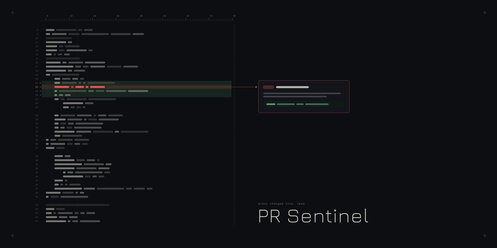
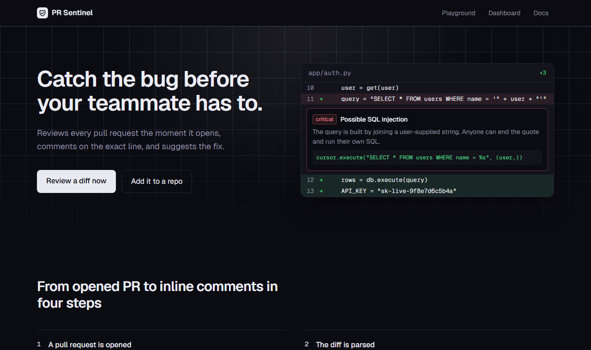

# PR Sentinel — AI Code Review Bot

[](https://github.com/kolipakamahendra1-wq/AI-code-review-Bot/actions/workflows/ci.yml)
   

A GitHub bot that reviews every pull request automatically. It reads the diff, comments on the **exact changed line**, explains the risk, suggests a fix, and gives the PR a score. It combines a **deterministic security rule engine** with an **LLM** (free local Ollama by default; OpenAI or Claude by config).

Ships as a **webhook service** (FastAPI), a **reusable GitHub Action**, and a **web dashboard + playground** (React).





## Why it's more than "send the diff to GPT"

| Problem | How it's handled |
|---|---|
| Small/local models miss obvious issues | 12 regex security rules (secrets, SQL injection, `eval`, `shell=True`, disabled TLS, unsafe deserialisation, XSS sinks…) run on every change. LLM findings win on duplicates because they explain more. |
| LLMs return line numbers that aren't in the diff, and GitHub rejects such comments | The diff parser tracks every visible line; findings are validated and snapped to the nearest changed line. |
| LLMs return broken JSON | Tolerant parser (code fences, surrounding prose) plus one retry; failures are recorded, not swallowed. |
| Anyone can POST to a webhook | HMAC-SHA256 signature check with constant-time compare; unset secret never validates. |
| Webhooks re-fire on every push | Idempotent per `(repo, PR, head SHA)`; drafts and closed PRs are ignored. |
| Vendor lock-in / cost | Provider interface: `ollama`, `openai`, `anthropic`, or `rules` (no model). |
| Slow CPU inference ruins demos | Playground has an **Instant** mode (rules only, milliseconds) and an **AI** mode. |

## Architecture

```
GitHub PR event ──► POST /api/webhooks/github  (HMAC verified, background task)
                        │
         fetch diff ──► diff parser (hunks, new-file line numbers, skip lockfiles/binaries)
                        │
                        ├─► rule engine (instant, deterministic)
                        └─► LLM per file (JSON findings, retry on bad JSON)
                        │
        validate lines ─► dedupe ─► severity filter ─► score (100 − penalties)
                        │
          one GitHub review with inline comments  ──►  SQLite  ──►  React dashboard
```

## Quick start

```bash
# backend (Python 3.12+)
cd backend
python -m venv .venv && . .venv/bin/activate      # Windows: .venv\Scripts\activate
pip install -r requirements.txt
pytest -q                                          # 27 tests, no network or model needed
uvicorn app.main:app --port 8020

# frontend
cd ../frontend && npm install && npm run dev       # http://localhost:5173
```

For AI mode install [Ollama](https://ollama.com) and `ollama pull qwen2.5:3b`. Without it, the Instant mode and the rule engine still work.

### As a GitHub Action

```yaml
on: pull_request
jobs:
  review:
    runs-on: ubuntu-latest
    permissions: { pull-requests: write, contents: read }
    steps:
      - uses: kolipakamahendra1-wq/AI-code-review-Bot@v1
        with:
          provider: openai     # ollama | openai | anthropic | rules
          fail-on: high        # fail the check on high/critical findings
        env:
          GITHUB_TOKEN: ${{ secrets.GITHUB_TOKEN }}
          OPENAI_API_KEY: ${{ secrets.OPENAI_API_KEY }}
```

### As a webhook service

1. Set `GITHUB_TOKEN` and `GITHUB_WEBHOOK_SECRET` (see `.env.example`).
2. Run the API (or `docker compose up --build`).
3. In the repo: Settings → Webhooks → payload URL `https://<host>/api/webhooks/github`, content type JSON, same secret, event **Pull requests**.
4. For local demos expose the port with a tunnel (`npx smee-client`).

## API

| Method | Path | Purpose |
|---|---|---|
| GET | `/api/health` | Provider, model and Ollama status |
| POST | `/api/webhooks/github` | Signed GitHub webhook (`ping`, `pull_request`) |
| POST | `/api/review/diff` | Review a pasted diff (`mode`: `ai` or `rules`) |
| POST | `/api/review/pr` | Review a PR by URL (`post: true` to comment) |
| GET | `/api/reviews`, `/api/reviews/{id}` | Review history and findings |
| GET | `/api/stats` | Totals, average score, findings by severity |

## Project layout

```
backend/app/   diff.py  rules.py  reviewer.py  llm.py  github.py  pipeline.py  db.py  main.py  cli.py
backend/tests/ diff parser, rules, reviewer (fake LLM), webhook auth, API, idempotency
frontend/src/  Landing · Playground · Dashboard · ReviewDetail · Docs
action.yml     reusable composite GitHub Action
.github/       CI (pytest + build) and a self-review workflow
```

## Tech

Python · FastAPI · Pydantic · httpx · SQLite · Ollama (qwen2.5:3b) · OpenAI / Anthropic APIs · GitHub REST API & Actions · React 19 · Vite · Tailwind CSS 4 · Docker · pytest

## Limitations and roadmap

- Reviews one file at a time, so cross-file bugs are out of scope; a repo-aware context pass is the next step.
- A 3B local model is slow on CPU and misses subtle bugs. That is the reason the rule engine exists. Use a larger model or a cloud provider for deeper reviews.
- Roadmap: GitHub App auth (installation tokens), per-repo config file, suggestion blocks (`​```suggestion`), Postgres option.

## License

MIT
